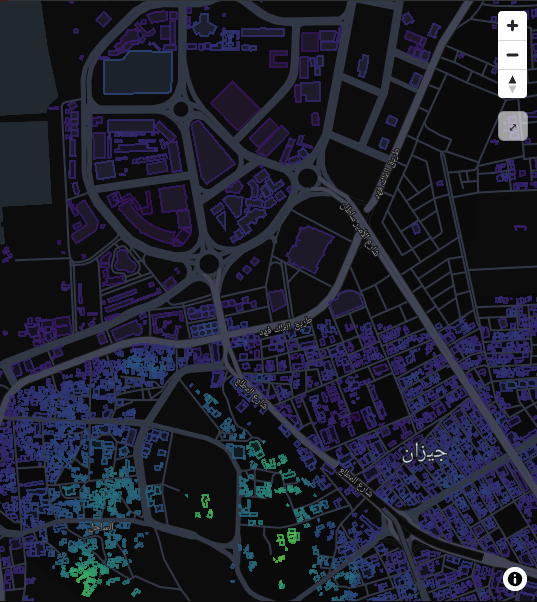
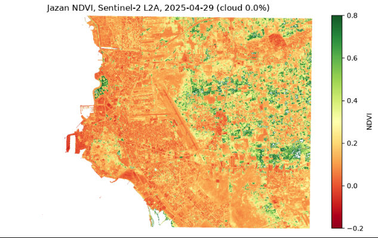

# Jazan on Wherobots: Cloud-Native Building Elevation and Sentinel-2 NDVI

Cloud-native geospatial analysis of Jazan city, Saudi Arabia, using [Wherobots](https://wherobots.com/) (WherobotsDB, built on Apache Sedona) and open data from the Wherobots Havasu catalog. Everything runs in the cloud with spatial SQL and Python. No data is downloaded to a local machine.

**Author:** Ali Abutaleb, PhD

## What this project does

| Notebook | Data | Method | Output |
|---|---|---|---|
| [`01_jazan_building_elevation.ipynb`](notebooks/01_jazan_building_elevation.ipynb) | Overture Maps buildings, Copernicus GLO-30 DEM | Spatial filter, raster/vector join, `RS_ZonalStats` | Mean elevation per building, interactive map, GeoParquet |
| [`02_jazan_sentinel2_ndvi.ipynb`](notebooks/02_jazan_sentinel2_ndvi.ipynb) | Sentinel-2 L2A (STAC table) | Scene search by cloud cover, COG clipping, `RS_MapAlgebra` | 10 m NDVI map, statistics, GeoTIFF |

Area of interest: Jazan city, 42.50 to 42.65 E, 16.85 to 16.95 N (EPSG:4326).

## Results

### 1. Mean elevation per building

- **24,229** Overture building footprints received an elevation value
- Mean elevation per building ranges from **-5.1 m to 55.4 m**, with an average of **9.2 m**
- 9 Copernicus DEM tiles cover the area; both datasets are in EPSG:4326, so no reprojection was needed

Notes: Copernicus GLO-30 is a 30 m surface model (DSM) referenced to the EGM2008 geoid, so it includes buildings and vegetation, and small negative values occur along the shoreline. At building scale, treat these values as a workflow demonstration rather than a survey-grade product.

### 2. Sentinel-2 NDVI

- Scene: Sentinel-2 L2A, **29 April 2025, 0% cloud cover**, selected automatically as the clearest scene fully covering the area
- **1,194,280** valid 10 m pixels; NDVI ranges from **-0.96 to 1.00**, mean **0.19**
- **16.5%** of valid pixels have NDVI above 0.3 (vegetation), concentrated in the farms and tree cover east of the city center

Reflectance is computed as `DN × scale + offset` using the values stored in the STAC metadata (offset of -0.1 for processing baseline 04.00 and later). Pixels with zero or negative reflectance after the offset (mostly open sea) are masked as no data, which keeps NDVI within the valid range of -1 to 1.

## Data sources

All data comes from the `wherobots_open_data` catalog in Wherobots Cloud:

| Table | Description |
|---|---|
| `overture_maps_foundation.buildings_building` | Overture Maps building footprints |
| `copernicus_dem.glo_30m` | Copernicus GLO-30 Digital Elevation Model |
| `imagery.copernicus_sentinel2_l2a_stac` | Sentinel-2 Level-2A scenes as a STAC table, with links to Cloud Optimized GeoTIFF bands |

## How to run

1. Create a Wherobots Cloud account (a free trial is available).
2. Start a Notebook Runtime (the **Micro** size is enough) in **AWS US West (Oregon)**.
3. Upload the notebooks from the `notebooks/` folder to **My Files**.
4. Select the **Python 3** kernel and run the cells in order.
5. Stop the runtime when you finish.

The first notebook finds table names and the geometry and raster columns automatically, so it keeps working if the catalog changes its table layout. To analyze another area, change `XMIN, YMIN, XMAX, YMAX` in the first cells.

## Cost

Running the official Getting Started notebook on a Micro runtime for about 27 minutes used roughly 0.5 Spatial Units (about $0.74 at Wherobots' published price of $1.50 per Spatial Unit).

## Tools

Wherobots Cloud, WherobotsDB, Apache Sedona (spatial SQL, `ST_` and `RS_` functions), Wherobots GL maps, Python, NumPy, Matplotlib.
